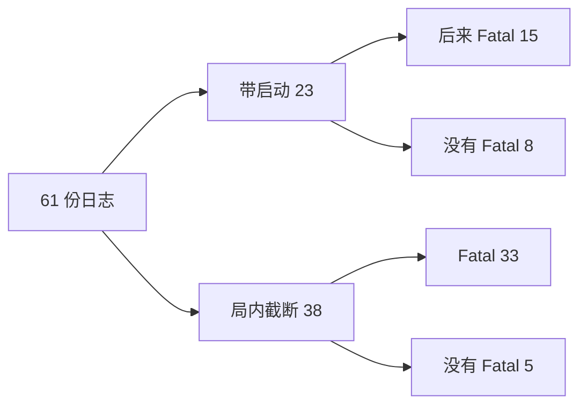
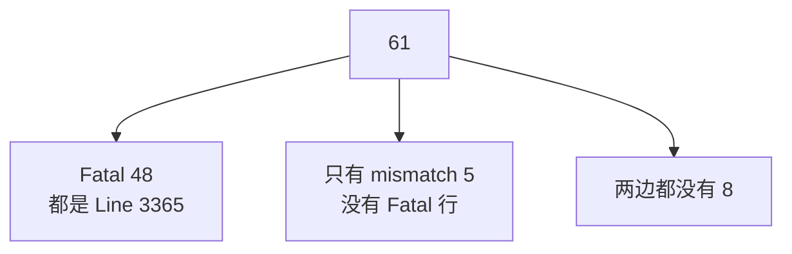
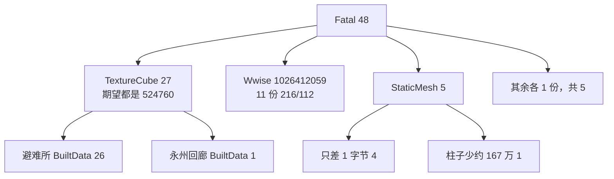
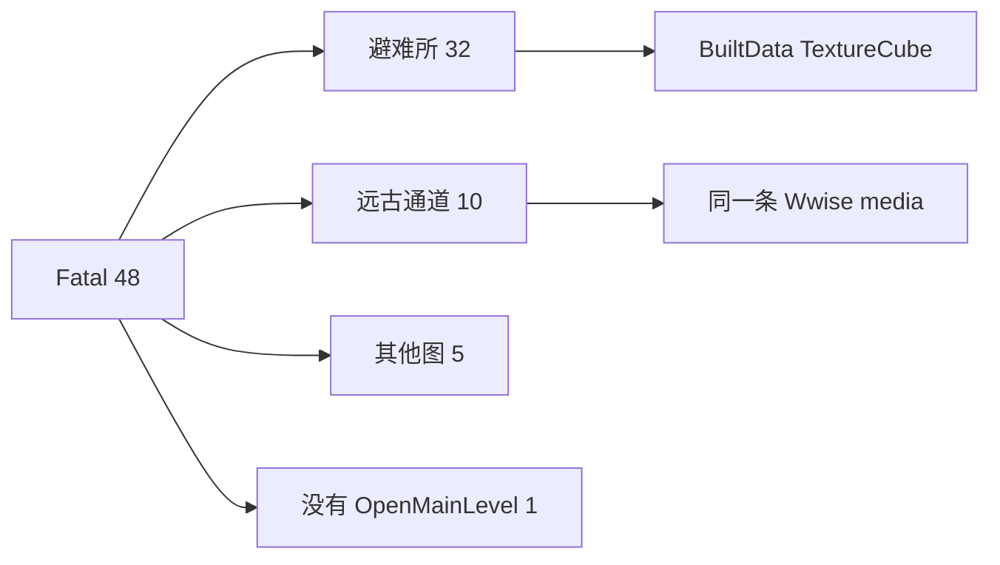
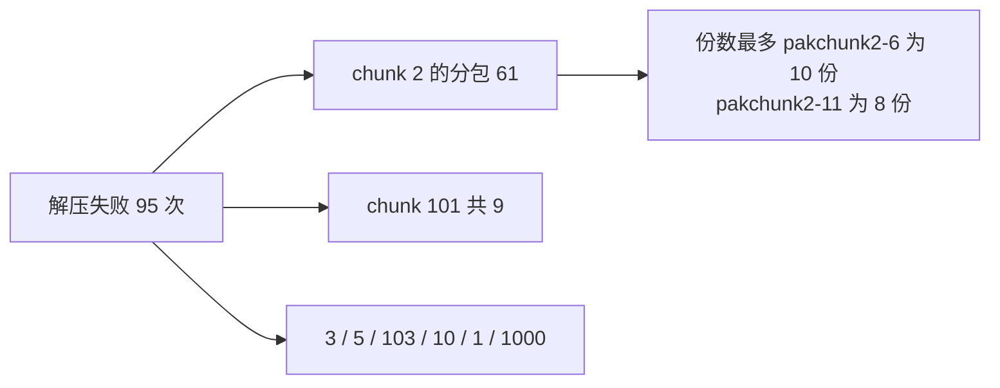
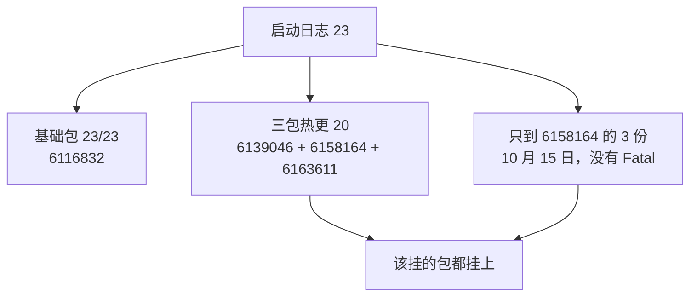
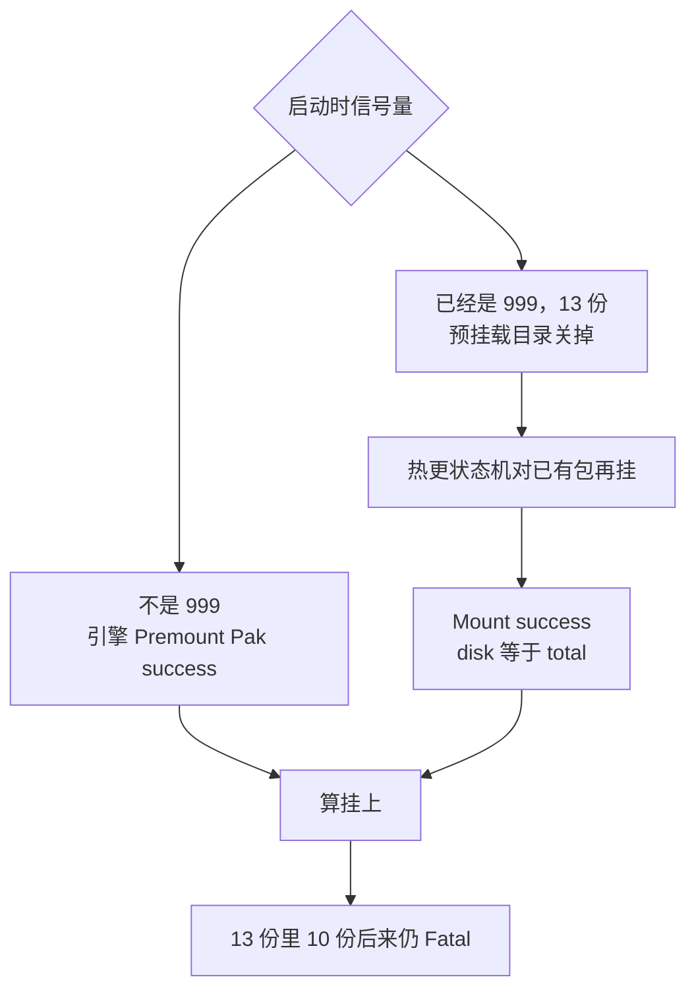
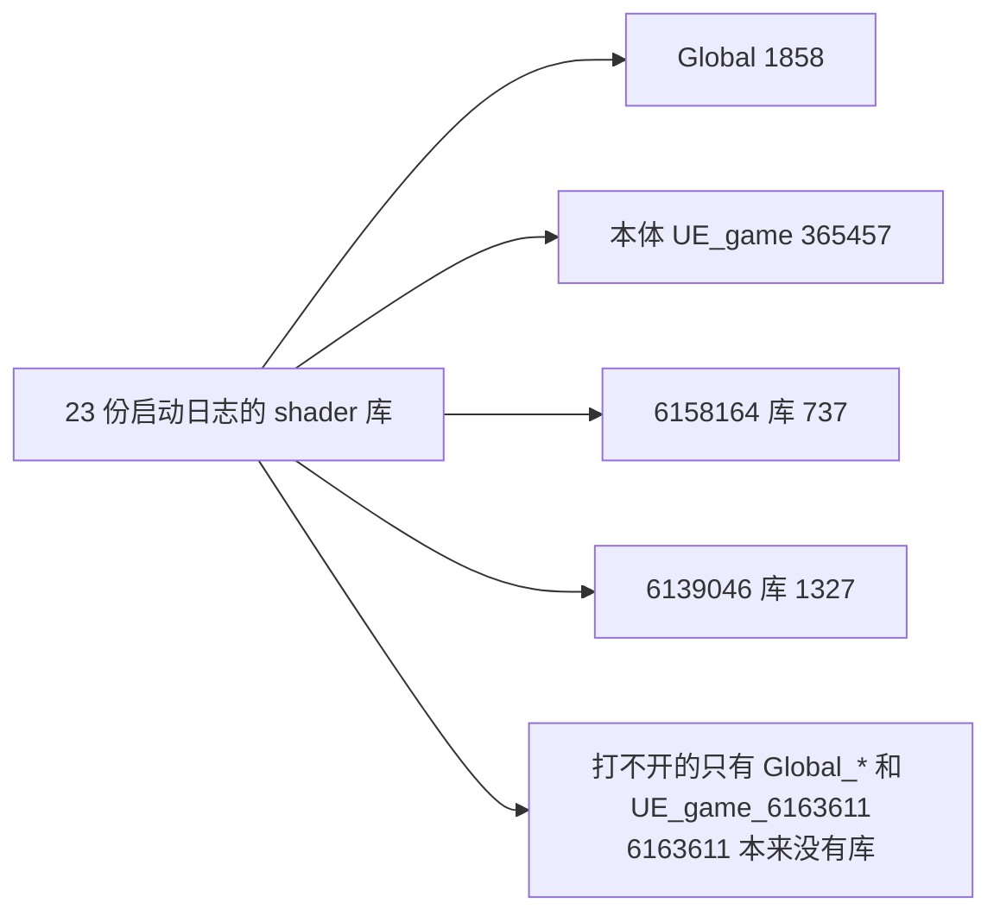

# 线上 pak corruption，61 份 Windows 日志

日志包是 `火炬之光（国内）_windows_玩家自定义日志_Fri Oct 16 2026 19_29_22`，61 个 txt，解压后合计约 327 MB。时间从 2026-10-15 05:16 到 2026-10-16 09:51。

<u>48 份是同一种 Fatal，都死在 `AsyncLoading.cpp:3365` 的 serial size mismatch。资产不是同一份，pakchunk 也不是同一个。基础包 CL 和热更 CL 在有启动记录的 23 份里是齐的，热更 mount 全部成功，没有 mount 失败。</u>

## 现状

- 日志形态：23 份带启动和热更，38 份从局内截进来。局内那 38 份看不到 mount，不能拿来判断挂载。
- Fatal：48 份。文本都是 `LogOutputDevice: Error: Fatal error: [File:Unknown] [Line: 3365]`。Shipping 把源文件路径裁掉了，行号还在。
- 有 serial size mismatch、但没打出 Fatal：5 份。既没有 mismatch、也没有 Fatal：8 份。
- 带启动的 23 份里，15 份后来 Fatal。局内截断的 38 份里，33 份 Fatal。

## Fatal

同一处检查，两种读坏方式。

- 27 份 TextureCube，期望长度都是 **524,760**。其中 26 份是 `XZ_YuJinZhiXiBiNanSuo200_BuildData_PC_BuiltData`，实际读到 190、28、77、90、129、6,530，差了约 50 万字节。另有 1 份读到 **17,039,744**，比期望多出 **16,514,984**。剩下 1 份是 `YJ_YongZhouHuiLang200` 的 BuiltData，读到 28。
- 11 份是同一个 Wwise 资源，`AkMediaAsset /Game/WwiseAudio_EBP/HotUpdate/Media/1026412059`，Got **216** / Expected **112**，多 104 字节。
- 5 份 StaticMesh。4 份只差 **1** 字节：`SM_PC_BeiFangShanDi_Shi_02_01`（155,188 / 155,187）、`SM_PC_BeiFangShanDi_Shu_02_02`、`SM_PC_YuJinZhiXi_YiJieMen_03_01`、`SM_YiJiBuZu_JianZhu_01_01`。`SM_DLWY_ZhuZi_02_01` 是 1,514 / 1,679,250，少了约 167 万。
- 各 1 份：`MI_PC_BeiFangShanDi_Cao_01_01`（4,408 / 231,293）、`M_FX_YiJieMenBloom1`（341 / 14,721）、`MapBuildDataRegistry` 的 Mobile BuiltData（多 2,048）、`ShadowMapTexture2D`（28 / 3,329）、`S15GameplayProgress` 的 easing（28 / 12）、`KD_AiRenDiSanCeng` 的 Mobile BuiltData TextureCube（28 / 524,760）。

差 1 字节的 4 份和少了几十万字节的 BuiltData 不是同一种坏法。前者像读到了相邻版本的 export，后者是这块字节本身坏了。38 份 Fatal 前面还有 `Bad name index .../91`，名字表只有 91 项，索引跑到 1,194,869,343 这种量级，和 BuiltData 那类对得上。

崩的时候人在哪张图：

- 32 份在 `XZ_YuJinZhiXiBiNanSuo200`
- 10 份在 `SD_YuanGuTongDao201`，对应那 11 份 Wwise 里的大多数
- 各 1 份：`DiaoLingWangYu_200`、`YJ_YongZhouHuiLang200`、`SQ_ZhuiXingJiShi200`、`JH_ShenHeJuSuo000`、`KD_AiRenDiSanCeng`
- 1 份 Fatal 前没有 OpenMainLevel

5 份只报了 mismatch、日志里没有 `Fatal error:`，也没有 `Got / Expected`。资产是 `SM_ZuiRenMiDian_DM_01_02_16`、3 份避难所 BuiltData 的 TextureCube、1 份 `AkMediaAsset 1557879`。这 5 份不能并进上面 48 份。

## pakchunk

<u>Fatal 那一行没有 pak 名。日志里能点名的 pakchunk，全部来自更早的 Oodle 解压失败，不是 Fatal 的调用现场。</u>

解压失败 24 份日志、95 次，每次下一行都是 `Retry was sucessful`。24 份里 23 份后来还是 Fatal，1 份没有 Fatal。失败散在 24 个 pak 上，按日志份数：

- `pakchunk2-6` 10 份，`pakchunk2-11` 8 份，`pakchunk2-5` 5 份，`pakchunk2-4` 4 份
- `pakchunk10`、`pakchunk5` 各 4 份，`pakchunk3`、`pakchunk2-7` 各 3 份
- `pakchunk2-0`、`pakchunk2-3`、`pakchunk2-14`、`pakchunk2-15`、`pakchunk1` 各 2 份
- 各 1 份：`pakchunk2-1`、`2-8`、`2-9`、`pakchunk101-0/1/4/5/6/8`、`pakchunk103`、`pakchunk1000`

按事件数，chunk 2 的各个分包合计 61 次，chunk 101 有 9 次，chunk 3、5、103、10、1、1000 都有。同一份日志里最多同时打到 7 个不同 pak。所以不是单一 `pakchunk2-11`。

这 24 个 pak 和上面的崩溃资产对不上。解压失败没有写出正在读的文件，Fatal 也没有写出 pak。6170660 就是补这个空档的。

## 版本和 mount

有启动记录的 23 份：

- 基础包：`require_version`、`local_version`、`baseVersion`、Themis 的 `Review_Release_` 都是 **6116832**。23 份内部没有对不上的。
- 热更：20 份是 6139046、6158164、6163611 三包。大小逐字节相同，1,546,893,059 / 86,503,184 / 75,648,470。客户端版本 `0.0.0.6163611.6163611`。
- 另外 3 份停在 6158164，客户端版本 `0.0.0.6158164.6158030`，时间是 10 月 15 日 05:16 到 10:47。这 3 份没有 Fatal。6163611 当时还没下到这台机器，不是挂载失败。
- 局内截断的 38 份里，34 份有 `+p4version [6163611]` 和 `app_version 6.4.0.2`，4 份连这个都没有。这 38 份没有基础包 CL。

mount：

- 23 份启动日志里，该挂的热更包都挂上了。引擎预挂载打 `Premount Pak success`，或者热更状态机打 `Mount success`，或者 `AlreadyMounted`。三种都算挂上。`mount failed`、`unmount_pak_failed` 是 0。
- 13 份启动时 `MountFailureSemaphore` 已经是 **999**，阈值 3，所以预挂载目录被关掉，并打了 `hotupdate_engine_premount_failed`。这是上一次 serial mismatch 写进 `mount_16.json` 的结果，不是这次 mount 调用失败。关掉之后，状态机对磁盘上已有的热更包再挂，`Mount success`，`disk == total`，没有重下。
- 这 13 份里 10 份后来仍然 Fatal。预挂载关掉挡不住这次崩溃。
- 基础 pakchunk 只在预挂载没被关掉的日志里看得到，`pakchunk2-0` 到 `pakchunk2-15` 都有，没有整包 `pakchunk2-WindowsNoEditor.pak`。被关掉预挂载的那 13 份看不到基础包挂载过程。

shader：

- 23 份启动日志的 shader 库一致：`Global` **1,858**，本体 `UE_game` **365,457**，`UE_game_6158164` **737**，`UE_game_6139046` **1,327**。
- `Can not open shader library` 只出现在 `Global_6139046`、`Global_6158164`、`Global_6163611`、`UE_game_6163611`。6163611 本来就没有 shader 库，和上次 PC review 笔记一致。这不是 shader 包损坏。
- 没有 `Missing Shader`。

MD5：61 份里没有 `MD5` 失败，也没有 checksum / hash mismatch。`PakFile PathHashIndexSize` 只是 index 字节数。

## 漏掉的部分

- 崩溃后客户端把 `mount_16.json` 的信号量写成 999。下一轮启动会先关掉预挂载，再由热更状态机把包挂回去。所以看到 `premount_failed` 不能当成热更没挂上。
- 8 份既没有 mismatch 也没有 Fatal。其中几份只进了 `LoginScene` 就结束，或者在别的图里正常跑完这段日志。`387902998367436851` 进了避难所，到 07:23 结束，没有崩。
- 崩在避难所的占 32/48。另外 10 份崩在远古通道，资产是同一条 Wwise media，不是 BuiltData。两条线不要合成一个资源。
- 日志证明不了 Steam 上的 `pakchunk2-N` 就是打 6139046 时用的那份 6116832。exe 只自报了 CL，没有基础 pak 的 hash。

## 接下来

- 6170660 已经 shelve 在 `//Torchlight/PrereviewUGS`。下一次这种 Fatal 会在死前打出 `PakFatal`：`chunk`、`order`、`indexHash`、`entryOff`、`entryHash`。`hit` 多于 1 才是同一个文件进了多个 pak。
- 拿到新日志之前，chunk index 对不上具体资产。现在只能说解压失败集中在 chunk 2 的分包，同时 chunk 1、3、5、10、101、103、1000 也有。
