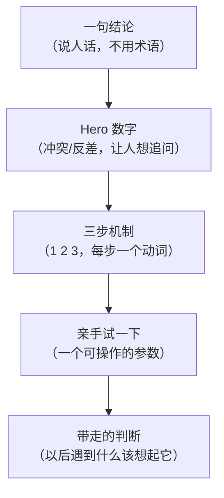

# Karpathy Explain Better

**一句话:看不懂,通常不是"不够详细",是"形式不对 + 废话太多"。**

Karpathy 的做法不是让模型再多写一段,是把答案**换一种形态**:
文字 → 结构图 → 可滑动海报 → 讲解视频。每一层都要比上一层**字数更少、信息更狠**。

## 五条硬规则(违反任何一条 = 返工)

| # | 规则 | 判定标准 |
|---|------|----------|
| R1 | **图先行** | 任何网页/视频,**先**出 Mermaid 逻辑链,再动手做;没有图不许开始排版 |
| R2 | **大字** | 每个视口/每页 **1 个 hero 数字**,字号 ≥ 视口短边 12%;它在 3 米外要能读到 |
| R3 | **禁 AI 词** | 中英各一张禁用表(`references/word-ban.md`),命中即替换成日常话 |
| R4 | **精要** | 一页 ≤ 45 个汉字(英文 ≤ 25 词);全片旁白字数 = 目标时长 × 4.5 字/秒,不超 |
| R5 | **背景要动** | 有背景就必须是动态的(慢移/呼吸/粒子/噪声呼吸);文字可以静止 |

R2 的意思不是"标题大一点",是**把结论压成一个数字**:

```
差:  卷积神经网络通过多层特征提取实现了对手写数字的有效识别
好:  784  →  10          (28×28 个像素,压成 10 个数字的概率)
```

数字必须是**可核对的事实**(来自原文/论文/实测),不许为了好看编。

## 心流链(所有形式的骨架)

解释要像一条下坡路,每屏只推进一步,不允许回头:



- **海报 = 这条链切成 3 页**:P1 结论+Hero / P2 三步机制 / P3 试一下+带走
- **视频 = 同一条链按时间展开**,每个分镜只承担一个箭头
- **文字版 = 同一顺序的五句话**,不是五段

链条写完先给用户看一眼再开工(30 秒成本,省掉整版返工)。模板见 `references/flow-first.md`。

## 四种形式

| 形式 | 何时用 | 关键产出 | 细则 |
|------|--------|----------|------|
| **简化文字** | 表达绕、术语多 | 5 句话 + 1 个例子 | `references/modes.md` §1 |
| **结构图** | 关系多、有分支 | Mermaid + 三句"怎么看" | `references/modes.md` §2 |
| **3 页海报** | 要"一屏看懂"、要发给人 | 单文件 HTML,左右滑动 + 自动播放 + 动态背景 | `references/boss-poster.md` |
| **讲解视频** | 节奏只能靠时间讲 | 字幕可开关 + 音量拉满 + 动态背景 | `references/video-spec.md` |

形式不是升级打怪:**一句话能讲清的别做视频**;能一页讲清的别做三页。

## 工作流(五个闸门,过不了不许往下走)

```
G0 定题     → 一句话:读者到底卡在哪?（不是"介绍 X"，是"X 到底在解什么问题"）
G1 画链     → Mermaid 心流链，5 个节点以内；先给用户看
G2 定字     → 每页一句 ≤45 字 + 1 个 hero 数字；先写纯文本卡，不碰样式
G3 出活     → HTML / 逐帧渲染 / 旁白合成
G4 机检     → python references/scripts/check_explain.py <产物>
G5 交付     → 附"怎么看"三句 + 机检结果，不附主观形容词
```

G2 是省时间的关键:**文案定了再排版**。反过来做,改一个字就要重排整页。

## 交付前自检

```bash
python references/scripts/check_explain.py <文件或目录>
```

它会查:禁用词命中 / 每页字数 / 是否有外链 / 视频是否有字幕轨 / 是否默认开 / 响度是否够 /
背景是否真的在动(逐帧差分,并给出"冻结帧占比")。**全绿才算过。**

视频的两个环节也有现成脚本,不用现写:

```bash
python references/scripts/tts_timeline.py narration.txt --out work/   # 逐句 TTS + 时间轴 + srt
python references/scripts/webvideo.py scene.html --work work/ --out out.mp4
```

人工再补四条:

- [ ] 3 米外能读到 hero 数字(缩略图 20% 大小还能看清)
- [ ] 每页只讲一件事;删掉任意一句,信息会缺
- [ ] 数字、公式、引用回到原文核对过
- [ ] 逐张看过缩略拼版(不是只看脚本报成功)

## 常见坑

- **"详细"是陷阱**:字数增加 3 倍,理解率不涨,读完率暴跌。先砍再补。
- **hero 数字不能是形容词**:`效率提升显著` 是废话,`6 个 5×5 卷积核` 才是事实。
- **动画不等于动效**:文字到处飞是噪音;背景缓慢流动 + 一个元素淡入才是节奏。
- **视频默认静音 / 默认带字幕 / 默认小声,都是交付缺陷**:字幕要能开关且默认开,音量要拉到平台上限。
- **场景目录里的 `timing.js` 会覆盖注入的 `window.TIMING`**:场景里的 `<script src>` 在注入之后执行,目录里留一份旧的就是整片错拍,而且零报错。渲染前必须**重写**它(`webvideo.py` 已做)。
- **字幕一句一 cue 会太长**:24 个汉字在 1080p 勉强、竖屏直接糊。在时间轴脚本里按标点折行,别留到渲染端。
- **揭示动画比句子慢**:逐字公式写到 `p*1.4` 就是“句子说完了还没打完”,取 `p*3.0`,让它在 p≤0.4 就位。
- **逐帧渲染别用 `-vf zoompan`**:整数裁剪会"冻一帧跳一格",改逐帧亚像素。
- **先存旧版再改**:成片 + md5 + 症状清单,否则无法对比 before/after。
- **Skill 工具报 unknown skill**:Cindy 从 `~/.claude/skills/` 加载,新 skill 必须落到那里。
- 字体、emoji、`U+FE0F`、ffprobe 缺失等渲染细节见 `references/form4-video-delivery.md`。
