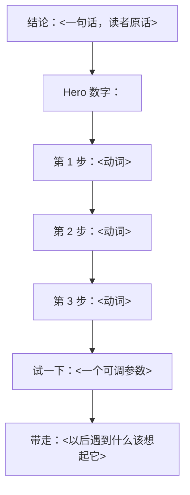

# 图先行:先画链,再做活

**规则:任何 HTML / 视频开工前,必须先产出一张 Mermaid 心流链,并让用户看过。**

理由:排版和渲染最贵,链条错了整版返工;Mermaid 改一行 5 秒。

## 产出模板(直接复制)

````markdown
## 逻辑链



## 分页映射

| 页 | 节点 | 主文案(≤45 字) | hero 数字 |
|---|------|------------------|-----------|
| P1 | A + B | | |
| P2 | C1..C3 | | |
| P3 | D + E | | |

## 事实核对

- hero 数字出处:<论文/文档/实测，带链接或文件名>
- 被删掉的细节:<列出，防止用户以为信息丢了>
````

## 判定标准(4 条,缺一条就打回)

1. **节点 ≤ 7 个**。超过说明你还没想清楚,继续合并。
2. **每个箭头是一个动作**(切/压/算/比对/试),不是"包含/属于"。
3. **相邻两节点有因果**,能念成"因为 A,所以 B"。念不通就是并列,应该并列在同一个节点里。
4. **B 是一个数字**,不是判断句。写不出数字 → 说明还没找到那个反差。

## 常见错法

| 错法 | 症状 | 改法 |
|------|------|------|
| 把目录画成图 | 节点全是名词(`输入层` `卷积层` `池化层`) | 换成动作:`6 个核扫一遍 → 每个位置压成 1 个数` |
| 链条带回路 | A→B→C→A | 回路说明你在讲系统,不是讲清一件事;拆成"一轮" |
| 一屏塞两层逻辑 | 节点 B 分出 3 支又各分出 3 支 | 只留主干,枝叶放到"试一下"里让读者自己点 |
| 图和正文对不上 | 图里 5 步,正文 7 段 | 正文按图删到 5 段 |

## 链条也要给读者看

成品里保留一个 `data-flow` 折叠区放这张图(Mermaid 源码或 SVG),
读者想看"全貌"时能展开——但默认收起,不要抢主视觉。
